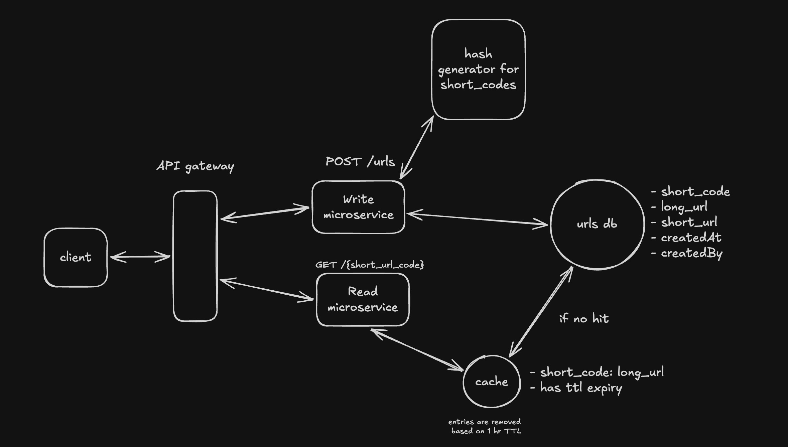

# URL Shortener

A simple URL shortener built with FastAPI, Postgres, and Redis.

Based on the following design (minus the gateway and microservices haha):



- **Postgres** stores the short codes and the URLs they point to.
- **Redis** caches lookups so redirects skip the database when they can (entries expire after 1 day).

## Running

Start Postgres and Redis:

```bash
docker compose up -d
```

Then start the API:

```bash
uv run uvicorn main:app --reload
```

The API runs at http://localhost:8000, with interactive docs at http://localhost:8000/docs.

| Service  | Host port | Notes                                                  |
| -------- | --------- | ------------------------------------------------------ |
| API      | 8000      |                                                        |
| Postgres | 5433      | Maps to 5432 in the container (avoids a local Postgres) |
| Redis    | 6379      |                                                        |

## Usage

Create a short URL:

```bash
curl -X POST http://localhost:8000/shorten \
  -H "Content-Type: application/json" \
  -d '{"url": "https://trevorharless.com"}'
```

```json
{
  "short_code": "aB3xYz",
  "short_url": "http://localhost:8000/aB3xYz",
  "original_url": "https://trevorharless.com/"
}
```

Follow it (the API sends a redirect to the original URL):

```bash
curl -i http://localhost:8000/aB3xYz
```

## Monitoring

### Redis

```bash
redis-cli monitor
```

Create or open a short URL and you'll see the `GET`/`SET` calls on `url:<code>` keys. A `GET` with no `SET` after it means the URL came from the cache. Press `Ctrl+C` to stop.

### Postgres

Open a `psql` shell inside the container:

```bash
docker compose exec postgres psql -U postgres -d shortener
```

Then run:

```sql
\dt                               
SELECT * FROM short_urls;         
```

Note: The Postgres container has no volume, so the data is lost when it's removed.
